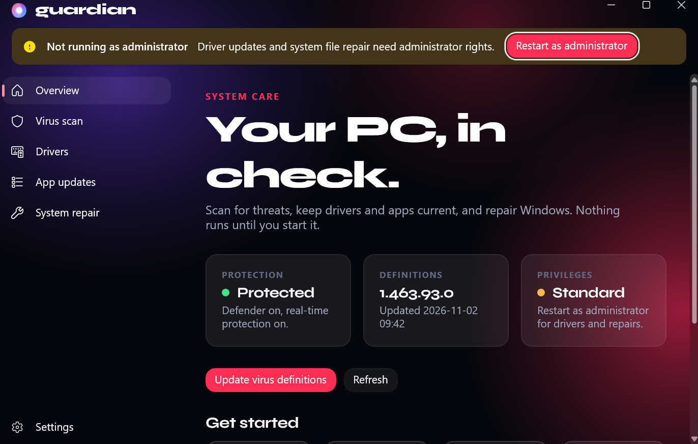
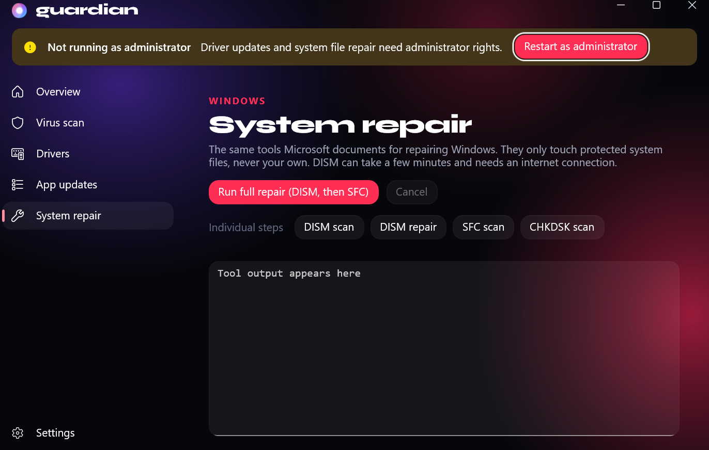
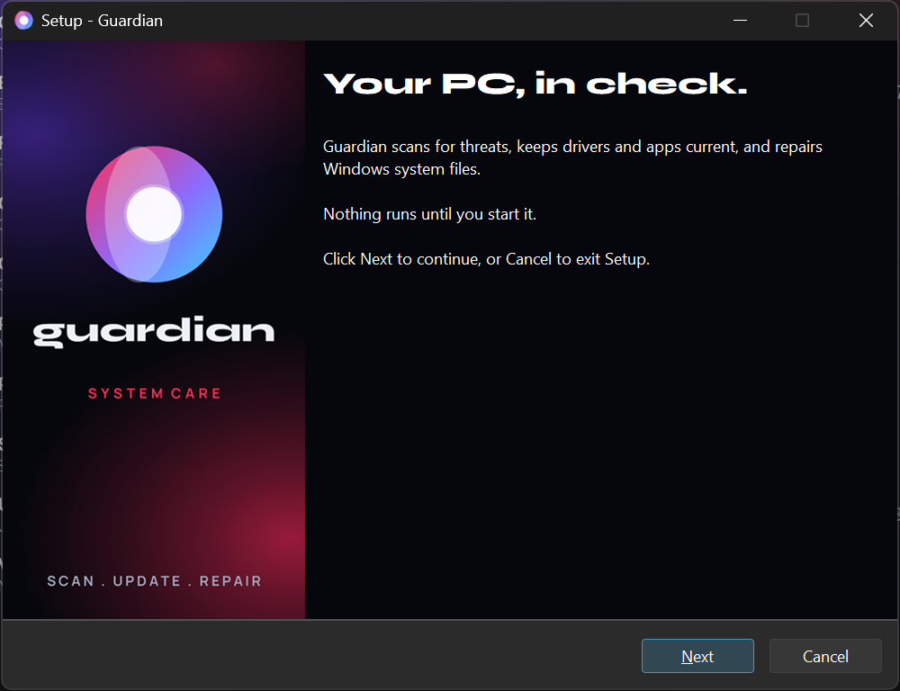
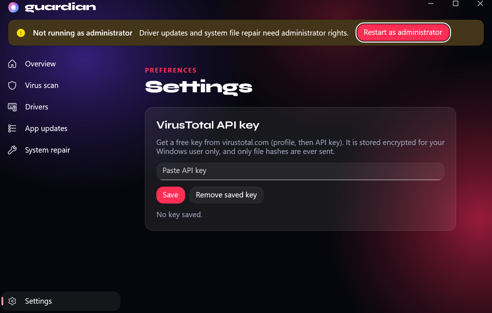

# Guardian

A Windows system-care app: scan for viruses, find outdated drivers and apps, and repair system files. Built with WinUI 3 on .NET 9, styled after the Lumen apps.



**[Download the installer](https://github.com/RivaDeveloper/system-guardian/releases/latest)** (Windows 10 1809+ / Windows 11, x64). The installer is not code-signed, so SmartScreen may warn about an unknown publisher.

## What it does

| | |
|---|---|
| **Deep scan** | Guardian's own scanner. Looks where malware hides and survives a reboot: Run keys, scheduled tasks, services, Winlogon, IFEO debuggers, AppInit DLLs, WMI subscriptions, running programs, kernel drivers (signatures, odd locations, known abused drivers), temp/AppData/ProgramData/Public/Recycle Bin folders and security settings that attackers switch off. Every finding lists the reasons it was flagged. Known-bad file hashes (LOLDrivers, signature-base) and ~5,000 YARA signature rules (YARA-Forge) are downloaded and matched locally; a rule hit counts as evidence, weighed by the rule's own confidence and the file's signature, never as a verdict by itself. Optional memory scanning refuses to run while an anti-cheat is active. Quarantine is reversible. Your documents, photos and ID scans are never opened. |
| **Virus scan** | Quick, full or folder scans through Windows Defender (`Start-MpScan`). An optional VirusTotal check hashes the newest executables in a folder and looks the hashes up. Files are never uploaded. |
| **Drivers** | Lists installed drivers (flags non-Microsoft ones older than 3 years) and asks Windows Update which driver updates are pending. A restore point is attempted before any install. |
| **Manufacturer drivers** | On the Drivers page: detects chipset, audio, LAN, Wi-Fi, Bluetooth, GPU and CPU drivers and compares them with the download table you copy from your motherboard or PC maker's page, since those sites block automated lookups. |
| **App updates** | Finds and installs updates through `winget`, one at a time or all at once. |
| **System repair** | DISM `/ScanHealth` and `/RestoreHealth`, `sfc /scannow`, and an online `chkdsk C: /scan`, with live progress and output. |
| **Cleanup** | Registry cleaner (leftover entries in HKEY_LOCAL_MACHINE, HKEY_CURRENT_USER and HKEY_CLASSES_ROOT: uninstallers, startup entries, fonts, COM objects, type libraries, context-menu items and file types that point at things that no longer exist; every fix backed up and restorable) and a junk-file cleaner for temp files and caches. |
| **System tools** | A grouped toolbox: debloat (remove pre-installed apps from a short safe list), tracks eraser, shortcut fixer, duplicate files and empty folders finders, uninstall, startup and process managers, disk space analyzer, system information and a BIOS update assistant that never flashes firmware itself (it checks power and BitLocker, makes a restore point and verifies your download), plus shortcuts to the cleanup, driver, update, repair and scan pages. |





## Design rules

- It wraps tools Windows already ships instead of reimplementing them. There is no custom detection engine, so Guardian is **not** a replacement for Defender or another antivirus.
- Nothing is removed, installed or repaired on its own. Every threat removal, driver install and repair is started by you, and removals show a confirmation listing what will be affected.
- The app starts without administrator rights and offers "Restart as administrator" for the parts that need it (driver installs, DISM, SFC).
- The VirusTotal API key is stored encrypted with DPAPI for the current Windows user. Only SHA-256 hashes are sent.



## Build and run

Requires Windows 10 1809+ (Windows 11 recommended) and the .NET 9 SDK.

```
dotnet build -p:Platform=x64
bin\x64\Debug\net9.0-windows10.0.19041.0\win-x64\Guardian.exe
```

Set `GUARDIAN_START_PAGE` to `scan`, `drivers`, `apps`, `cleanup`, `tools`, `repair` or `settings` to open straight to a page.

## Updates

Guardian checks this repo's latest GitHub release at startup (at most every 12 hours) and shows a banner when a newer version exists. **Update now** downloads the installer, verifies its SHA-256 against the checksum GitHub publishes for the release asset, runs it silently and reopens Guardian. Windows asks for permission if the install needs administrator rights.

Turn the automatic check off, or check on demand, under **Settings > Updates**. Releases without a published checksum are never installed automatically.

## Releasing

1. Bump `<Version>` in `Guardian.csproj`.
2. Run `powershell -ExecutionPolicy Bypass -File installer\build.ps1`. It fetches the pinned YARA engine, publishes the app and builds `dist\Guardian-Setup-<version>.exe`.
3. Publish a GitHub release tagged `v<version>` with that file attached. Installed copies pick it up on their own.

## Project layout

- `Services/` runs and parses the underlying tools (`DefenderService`, `DriverService`, `AppUpdateService`, `RepairService`, `VirusTotalService`).
- `Pages/` has one XAML page per section.
- `Assets/` holds the fonts and ambient background.

## Credits and licenses

See [THIRD-PARTY-NOTICES.md](THIRD-PARTY-NOTICES.md) for the YARA engine, the YARA-Forge rules, LOLDrivers and the hash lists the deep scan uses.

The Syne and Manrope fonts in `Assets/Fonts` are licensed under the [SIL Open Font License 1.1](https://openfontlicense.org). See the upstream projects for their copyright notices: [Syne](https://github.com/googlefonts/syne) and [Manrope](https://github.com/sharanda/manrope).

